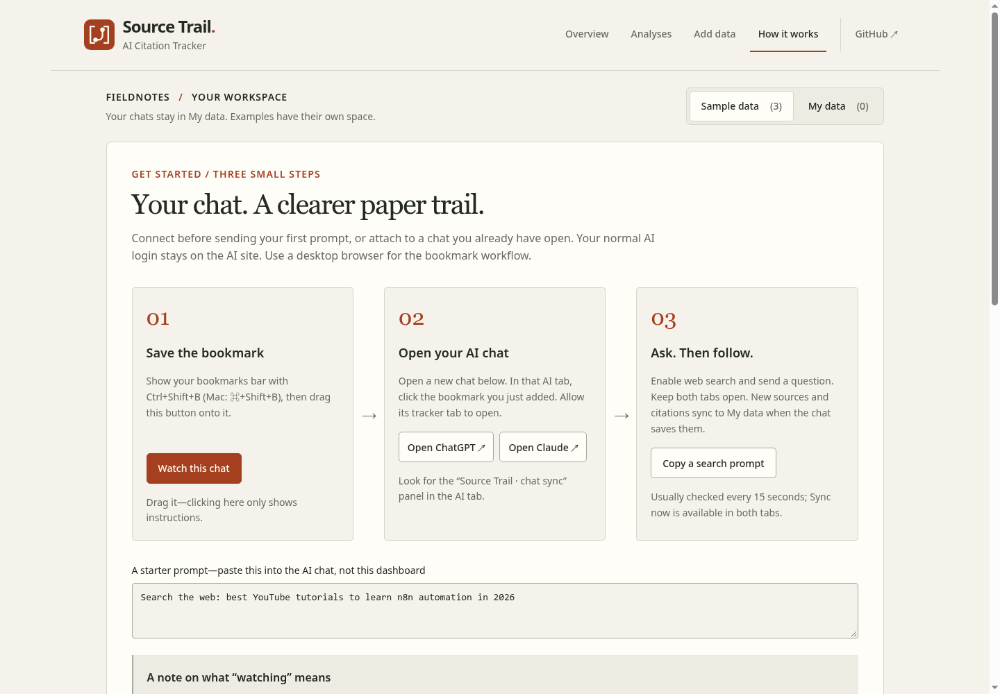

# Source Trail · AI Citation Tracker

See which sources an AI chat retrieves—and which it cites. A static, local-first dashboard with bookmark-based synchronization for new or existing ChatGPT and Claude chats.

**[Hosted dashboard](https://primetree2.github.io/ai-citation-tracker/)** · [Chat guide](docs/WATCH_CHAT.md) · [Deployment guide](docs/DEPLOYMENT.md) · [Requirement audit](docs/REQUIREMENTS.md)

> **Scope:** automatic **saved-chat sync**, not token-by-token network-stream capture. Real authenticated ChatGPT/Claude verification remains pending; the connection flow is tested using local synthetic provider pages. Private endpoints and browser policies can change or block it.

## The interface

Source Trail is the product's visual identity; **AI Citation Tracker** remains its descriptor. The repository name, GitHub Pages address, browser storage keys, and export formats are unchanged.

- A custom citation-path SVG mark replaces the placeholder icon.
- Warm paper, dark ink, and a restrained rust accent replace the generic blue-card styling. Green is reserved for matched citation evidence.
- An editorial headline and clearly labelled source-flow schematic explain the purpose without invented statistics.
- The bookmark-first three-step guide remains the main onboarding path. Samples are optional and separate from personal data.
- Responsive source cards, visible keyboard focus, reduced-motion support, and an OS-aware dark palette are included. No external fonts or UI dependencies are loaded.




## Use it on GitHub Pages

No Python, Node.js, API key, or backend is needed to use the hosted dashboard.

1. Open the hosted site and select **How it works**.
2. Show your desktop bookmarks bar: **Ctrl+Shift+B**, or **⌘+Shift+B** on Mac. Drag **Watch this chat** onto it.
3. Open a new or existing ChatGPT/Claude chat and click that bookmark **inside the AI tab**. Allow its tracker tab to open.
4. Enable web search and send a prompt. Keep both tabs open. Available saved evidence syncs into **My data** about every 15 seconds; follow-ups update the same conversation analysis.
5. Use **Sync now**, **Pause/Resume**, **Stop**, or **Save snapshot** as needed. Search sources and export the visible rows or the whole selected collection.

**Replace older bookmarks after upgrading.** Add the new bookmark from the **hosted site** if you want it to open GitHub Pages. A bookmark created on localhost still points to localhost. Local and hosted browser storage are separate—export/import JSON to transfer a collection. See [troubleshooting](docs/WATCH_CHAT.md).

Examples remain optional and separate from personal data.

## Update your existing GitHub-connected folder

**Yes: copy the contents into your existing repository. Do not nest another project folder or replace `.git`.**

For the folder you described, the result should be:

```text
Desktop/ai-citation-tracker/
  .git/                         keep your existing Git history/remotes
  .github/workflows/             copy/replace the supplied workflow files
  .nojekyll
  index.html
  package.json
  README.md
  site/
  src/
  runner/
  sample-data/
  sample-output/
  tests/
  docs/
  start-local.bat
```

1. Download and extract `ai-citation-tracker-redesigned.zip` into a **fresh** Downloads folder.
2. Open the extracted **`ai-citation-tracker-main`** folder.
3. Copy **everything inside it**, including `.github`, `.gitignore`, and `.nojekyll`, into your existing `Desktop/ai-citation-tracker`. Replace matching project files.
4. Keep the existing `.git` directory, any reviewed `CNAME`, and any repository-specific configuration you intentionally maintain. The ZIP contains no `.git` directory. Review the diff before pushing; do not blindly delete unrelated files.
5. In your existing repository terminal:

```powershell
# First confirm you are in the existing repository, not Downloads.
git remote -v
git branch --show-current
git status
git diff --stat

# After reviewing changes and confirming no private captures or secrets are staged:
git add .
git diff --cached --stat
git diff --cached

git commit -m "Deploy chat-first citation tracker"
git push origin main
```

The push command assumes your publishing branch is **main**. If your repository uses a different branch, use the correct branch and align Pages settings/workflow triggers deliberately; do not rename or force-push a branch just to follow this example.

**Do not copy the outer folder itself** into the repository: `ai-citation-tracker/ai-citation-tracker-main/site/` is the wrong structure for the supplied root deployment. A clean Git status while working only in Downloads does not update your Desktop repository.

## Choose your GitHub Pages publishing mode (once)

Pushing only deploys automatically if Pages is configured. Both modes below are supported:

### A · Keep existing branch deployment (simplest)

In **GitHub → repository → Settings → Pages**:

- **Source:** Deploy from a branch
- **Branch:** `main`
- **Folder:** `/(root)`

If these are already your settings, **no publishing-mode change is needed**. Push the copied files; GitHub's built-in Pages deployment publishes them. The custom `Deploy GitHub Pages` workflow detects branch mode and intentionally skips its own deployment.

### B · Use GitHub Actions deployment

In **Settings → Pages**, set **Source → GitHub Actions**. Push to `main`, or run **Actions → Deploy GitHub Pages → Run workflow** after changing the setting.

The supplied workflow checks the configured Pages source. In Actions mode, it validates/tests the project, prepares an allowlisted `_site/` artifact, and deploys it with the official Pages actions. Build output is not committed. If Pages is disabled or its settings cannot be read, the workflow warns and does **not** claim deployment succeeded.

The job needs the included `pages: write` and `id-token: write` permissions; repository/organization policies and environment protection rules can still require owner action. Details, safety notes, and failure fixes are in [DEPLOYMENT.md](docs/DEPLOYMENT.md).

## Check the deployment

1. Watch **Actions** for unit tests, static release checks, and the relevant Pages deployment.
2. Open `https://primetree2.github.io/ai-citation-tracker/`. The root redirects to `site/` with project-relative asset paths.
3. Confirm **Connect my AI chat**, **Watch this chat**, and the bookmark-first guide are present. If stale, hard-refresh with **Ctrl+Shift+R** (Mac: **⌘+Shift+R**).
4. Re-add the bookmark from this hosted address. Try one authorized web-search chat, then check connection status, source counts, follow-up refresh, Pause/Stop, and export.

The hosted workflow remains subject to the same browser/private-endpoint limitations as local use. Deploying is not proof of authenticated provider compatibility or completion of the research task.

## Run locally (optional)

```powershell
python runner/serve.py
```

Or double-click **start-local.bat** on Windows. The launcher opens `http://127.0.0.1:8000/`; keep the terminal open. If the port is occupied, stop the old server or use `python runner/serve.py --port 8001`. Do not use Python's `[::]` bind address as a browser URL, and do not double-click the HTML file.

## Development checks

Node.js **22+** is needed for development checks, not for hosted use. There are no production npm dependencies and no `npm install` step.

```powershell
npm run check          # Syntax, assets, relative paths, generated parser freshness
npm test               # 46 parser/watcher tests
npm run build          # Rebuild site/parser.js after changing src/
npm run build:pages    # Build parser and prepare public _site/ artifact
npm run test:pages     # Optional Chromium test of _site/ at /ai-citation-tracker/
```

Commit the generated `site/parser.js` when changing the parser source. The freshness check does not rewrite files. Additional browser, chat-sync, launcher, and synthetic capture tests are described in [TESTING.md](docs/TESTING.md).

## Data, privacy, and research boundaries

- Imports are parsed locally. Only normalized evidence is kept in localStorage—not complete raw chats. Storage is origin-wide, unencrypted, and not synced across devices. Scripts/people with access to the same origin/browser profile may read it.
- The bookmark sends the selected conversation directly from the AI tab to the tracker tab. Its ChatGPT auth token stays in the AI tab; it is not posted, exported, or stored by this code. Switching chats in that tab changes what is synced. [Details](docs/WATCH_CHAT.md).
- Sample data stays separate from My data. The supplied ChatGPT artifact contains **42 exact URL variants → 29 normalized retrieved sources, 7 cited**; Claude has **9 retrieved, 7 cited**. Extra API fixtures are synthetic, not new platform research. Retrieval is not proof a page was read.
- Private captures, browser profiles, cookies/tokens, `.env` files, and unrevised private exports must never enter Git. `.gitignore` does not protect files already tracked. Inspect the staged diff and public fixtures before pushing.
- Branch-root deployment publishes the repository's tracked public site files; Actions mode deploys only the allowlisted artifact. A **public repository still exposes its committed source files regardless of which assets Pages deploys**.
- Live ChatGPT stream capture, observable live-only fan-out queries, rich YouTube metadata verification, and the final recruiter handoff remain separate pending work. See the [requirement audit](docs/REQUIREMENTS.md), [formats](docs/FORMATS.md), [capture guide](docs/CAPTURE.md), and [submission template](docs/SUBMISSION.md).
