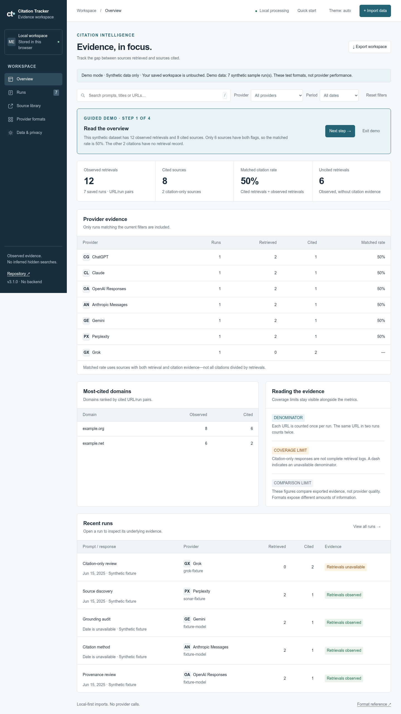

# AI Citation Tracker

I built a local-first evidence workspace to answer a specific question: **which sources can I observe in an AI response, and which of those sources does the answer cite?**

I use a restrained research-desk interface rather than a marketing landing page. I can inspect seven provider formats, review evidence paths, filter runs, export my data, and keep retrievals separate from citations. I don’t equate a missing search log with zero searches.

**My live deployment:** https://primetree2.github.io/ai-citation-tracker/  
**My repository:** https://github.com/primetree2/ai-citation-tracker

I still need to publish this v3 repository before those links show the upgraded version.



## How I make this easy to review

I open the hosted site and choose **Quick start → Try 60-second demo**. I do not need an account, API key, upload, or installation to try the deployed demo. My guided steps cover the overview, one run inspector, citation-only sources, and export. I keep demo data in memory, separate from saved runs; **Exit demo** restores the existing workspace.

I use **Quick start → Preview example import** to test ingestion without finding a file. I can also choose **Preview original case evidence** to review the earlier supplied ChatGPT/Claude source extracts. I label that evidence as saved-chat data, not a successful stream capture.

I keep a [one-minute reviewer path](docs/QUICKSTART.md), an [honest audit against the original brief](docs/TASK-AUDIT.md), and a [submission draft with fields I must complete](docs/SUBMISSION.md). **I do not claim the full assignment is complete:** ChatGPT live-stream capture, its fan-out queries, and richer YouTube metadata remain unverified. The brief explicitly allows explained partial work.

## How I start

I install Node.js 22 LTS or newer, open a terminal in the folder containing `package.json`, and run:

```powershell
npm start
```

I open **http://localhost:4173**. I do not need `npm install`, an API key, a database, or a build step. I stop the server with `Ctrl+C`.

I can also run `python -m http.server 4173` from the repository root. I use HTTP instead of double-clicking `index.html`, because browser module and example-file loading require a server.

## What I can do

- I import multiple JSON files, JSONL batches, pasted JSON, and v3 workspace backups.
- I preserve available source snippets, publication dates, attribution, and explicitly supplied channel/engagement metadata in JSON and CSV. I leave absent fields absent.
- I preview my batch before saving. I see file-specific errors and explicit replacement behavior.
- I inspect ChatGPT and Claude saved conversations, OpenAI Responses, Anthropic Messages, Gemini grounding, Perplexity Sonar, and Grok chat-completion citation payloads.
- I review source-level evidence paths and provider-specific limitations in each run.
- I filter my workspace by provider, response date, and text; I filter my source library by evidence status and sort by title, domain, or citation flag.
- I export an unfiltered JSON backup or a source CSV using my current source-library filters.
- I use responsive navigation, keyboard focus, native dialogs, `/` to search, and an automatic/light/dark theme.
- I migrate my older v1 browser workspace when it is on the same origin.
- I use the same parsing core in my browser and command-line tool.

## What I don’t claim

I do not include live account integrations, an automated browser runner, or a production-ready bookmarklet. I intentionally removed reliance on private authenticated endpoints. I bring in saved response files myself.

I have fixture-tested the supported fields, not every provider API version or authenticated website. I label all bundled demos as **synthetic**, use reserved example domains, and do not present sample counts as provider benchmarks. I don’t support arbitrary scraped pages, screenshots, SSE streams, HAR files, or copied answer text.

## My compatibility boundary

| My provider | My supported saved format | My retrieval evidence | My citation evidence |
| --- | --- | --- | --- |
| ChatGPT | Conversation JSON with `mapping` | Search-result entries | Assistant references / content references |
| Claude | Chat JSON with `chat_messages` | Named search tool results | Assistant text citations |
| OpenAI | Responses API `object: "response"` | Included web-search action sources | URL annotations |
| Anthropic | Messages API `type: "message"` | Web-search tool results | Text-block web citations |
| Gemini | `generateContent` response | First-candidate grounding chunks | Grounding-support indices |
| Perplexity | Sonar chat-completion response | `search_results`, when present | `citations` / URL annotations |
| Grok | Grok chat-completion response | Only explicit `search_results`, if present | Citation arrays / URL annotations |
| My other providers | My normalized v3 JSON | My explicitly mapped flag | My explicitly mapped flag |

I use [my provider reference](docs/PROVIDERS.md) for field paths and [my schema reference](docs/SCHEMA.md) for custom imports. I do not claim native Copilot, Mistral, or DeepSeek export support; I map those through my normalized schema.

## How I use my workspace

1. I choose **Try 60-second demo** for a clearly labeled synthetic walkthrough, or **Import data** for my own saved JSON.
2. I preview the files and choose **Save previewed runs**. I replace an existing run only when both provider and run ID match.
3. I open **Runs** and click a title to inspect observed queries, sources, evidence paths, and warnings.
4. I use **Source library** to review cited, uncited-retrieved, and citation-only sources.
5. I export my JSON backup before clearing data or switching devices.

I use URL/run pairs: the same normalized URL in two different runs counts twice. My matched citation rate is **retrieved-and-cited URLs ÷ observed retrieved URLs**. I exclude citation-only URLs from the numerator. I show a dash when I have no retrieval denominator.

## How I publish on GitHub Pages

I follow [my Windows upgrade guide](docs/DEPLOYMENT.md). My shortest path is:

1. I back up my existing workspace and repository.
2. I copy this ZIP’s **contents** into my existing repository, with `index.html` and `package.json` at the top level. I do not replace my `.git` folder.
3. I run my checks and push:

```powershell
npm run check
npm test
git add .
git commit -m "Rebuild citation workspace with multi-provider evidence imports"
git push
```

4. In GitHub **Settings → Pages**, I choose **Deploy from a branch**, `main`, and `/ (root)`.
5. I wait for deployment, then open my site and press `Ctrl+F5`.

I don’t need Netlify, a GitHub Pages build workflow, or a paid hosting plan. I use relative asset paths so repository-path hosting works. I keep `.nojekyll` at the root. My included GitHub Action runs checks; it does not deploy the site.

## My repository map

```text
index.html                  My static entry page
src/
  core/
    adapters.js             My provider parsers and import dispatcher
    model.js                My URL rules, normalization, and metrics
    storage.js              My versioned storage and v1 migration
    export.js               My JSON and safe CSV serializers
  ui/
    app.js                  My view composition and event handling
    styles.css              My responsive theme and components
public/
  examples/                 My synthetic provider fixtures and custom template
  favicon.svg               My local icon
tools/                     My local server, CLI parser, and syntax checks
tests/                     My core regression tests and browser smoke harness
docs/                      My deployment, architecture, schema, privacy, and QA notes
.github/workflows/ci.yml     My checks on pushes and pull requests
```

## My command-line workflow

```powershell
node tools/parse.mjs public/examples/openai.json --out my-workspace.json
node tools/parse.mjs public/examples/claude.json public/examples/grok.json --csv my-sources.csv
node tools/parse.mjs my-responses.jsonl --out my-workspace.json --csv my-sources.csv
```

I keep private input and output files in a `my-data/` directory, which my `.gitignore` excludes. I still review `git diff --cached` before every push.

## How I verify changes

```powershell
npm run check
npm test
npm run test:browser
```

I use the optional browser command when Chrome/Chromium is installed. I run dependency-free Node checks and regression tests. I use [my testing notes](docs/TESTING.md) for browser checks, limitations, and a manual release checklist. I keep [my architecture notes](docs/ARCHITECTURE.md) alongside my code so I can extend an adapter without changing the UI.

## My privacy model

I parse files locally and store normalized runs in localStorage. I don’t retain the full uploaded JSON, transmit imported content, or embed analytics or remote fonts. I treat browser storage as readable local data, not encrypted storage. I use [my privacy notes](docs/PRIVACY.md) before importing sensitive files.

## My license

I release my code under the MIT license in [LICENSE](LICENSE).
