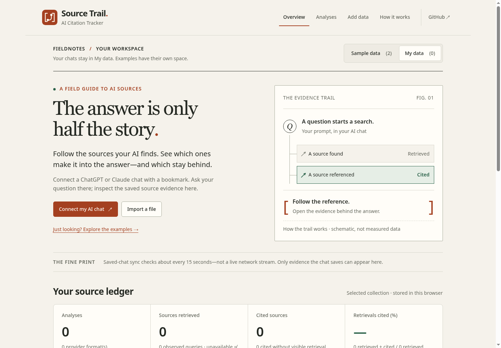

# AI Citation Tracker

I built a small, local-first dashboard to inspect **which sources an AI response retrieved and which it cited**. I kept my original four tabs—Overview, Runs, Add data, and How it works—instead of turning the project into a larger workspace app.

**[Live site](https://primetree2.github.io/ai-citation-tracker/)** · [My requirement audit](docs/REQUIREMENTS.md) · [My capture workflow](docs/CAPTURE.md)

## My 30-second demo

1. I open the live site and click **Try the original samples**.
2. I select a run on **Runs**. I can inspect search queries, evidence limits, source links, and **Full source snapshot**.
3. I use **Export sources CSV** or **Export JSON** on Runs.
4. I open **Add data → Try another provider format** to test an API fixture without a login or API key.

I expect **29 retrieved / 7 cited for ChatGPT**, and **9 retrieved / 7 cited for Claude** in the supplied saved-chat files. I have no observable ChatGPT fan-out queries in that original file; I have one in the Claude file. I do not present missing data as zero searches.

I make no provider request when loading these samples. My five extra API samples are explicitly synthetic, not new real-world research. I label the preloaded original evidence and remove it when importing a response; I do not silently mix it with a fresh import. I can re-load either original sample at any time.



## What I changed

- I preserved the original navigation, inline run details, sample buttons, and simple overview.
- I added saved-response adapters for OpenAI Responses, Anthropic Messages, Gemini grounding, Perplexity Sonar, and Grok/xAI, alongside ChatGPT and Claude saved chats.
- I added JSONL, round-trip workspace JSON, HAR response-content imports, supported SSE event reconstruction, and an optional local Chrome capture utility.
- I keep retrieved, cited, and citation-only evidence distinct. My matched rate is **retrieved AND cited / retrieved**, not all citations / retrieved.
- I preserve available source snippets and mapped metadata without truncating the exported values. I can expand the snapshot in the UI.
- I added parser tests, visible import failures, safer URL handling, formula-safe CSV, keyboard-accessible run buttons, and contained mobile tables.

## My scope, without overclaiming

I have verified the original two saved-chat files and the included synthetic fixtures. I have tested the capture utility end to end against a **local synthetic SSE server**, not authenticated provider websites. I still need a successful live ChatGPT stream capture and real rich YouTube metadata to substantiate the original task's full investigation. I treat the extra provider API adapters as compatibility work, not proof that I investigated those consumer sites' live traffic.

I can submit a partial investigation because the brief permits partial work. I cannot honestly mark every task complete yet. I keep the exact gaps in [my requirement audit](docs/REQUIREMENTS.md).

## My GitHub Pages setup

I host this as a static site; I do not need Netlify, a backend, a database service, an API key, or a build step.

1. I copy the repository contents into my existing `ai-citation-tracker` Git working folder, preserving `.git`.
2. I push to `main`.
3. In GitHub **Settings → Pages**, I choose **Deploy from a branch**, **main**, and **/(root)**.
4. I open `https://primetree2.github.io/ai-citation-tracker/`. The root redirects to `site/`.

I keep `sample-data/` next to `site/` so sample buttons work. If I previously configured a different Pages workflow, I select branch deployment or deliberately adapt that workflow. I do not publish a browser profile, raw HAR, private capture, or credentials.

### My safe PowerShell copy workflow

I download this release as `ai-citation-tracker-simple-upgrade.zip`. I use a fresh extraction folder rather than mixing two old ZIP extractions.

```powershell
$zip = Join-Path $HOME "Downloads\ai-citation-tracker-simple-upgrade.zip"
$extract = Join-Path $HOME ("Downloads\citation-upgrade-" + (Get-Date -Format "yyyyMMdd-HHmmss"))
$repo = Join-Path $HOME "OneDrive\Desktop\ai-citation-tracker"
Expand-Archive -LiteralPath $zip -DestinationPath $extract
$source = Join-Path $extract "ai-citation-tracker-main"
if (!(Test-Path (Join-Path $source "site\index.html"))) { throw "Extracted project not found" }
if (!(Test-Path (Join-Path $repo ".git"))) { throw "Existing Git repository not found" }
robocopy $source $repo /E /XD .git node_modules browser-profile .capture-profile __pycache__ test-results /XF *.pyc
if ($LASTEXITCODE -ge 8) { throw "Copy failed; inspect robocopy output before pushing" }
Set-Location $repo
git status
git diff --stat
# I inspect the changes before staging them.
git add .
git diff --cached --stat
git commit -m "Keep original UI and extend provider evidence support"
git push origin main
```

I do **not** use `/MIR`, which could delete files. I use `git status` to check for old untracked files from another version before staging. This copy overlays matching files but intentionally does not delete unrelated files. I never replace or remove my existing `.git` directory. A clean status after extraction into Downloads alone is expected; Git only sees changes after I copy them into the working folder.

## My local preview

I run this from the repository root with Python installed:

```powershell
python -m http.server 8000
```

I open `http://localhost:8000/`. I do not double-click `site/index.html`, because local `file://` restrictions can break sample fetches. My local and GitHub Pages browser storage are separate because they have different origins.

## My own data

I use **Add data** to upload a supported saved response, HAR containing response bodies, `.jsonl`, or `.sse` file. I choose the raw-stream provider for raw SSE; regular JSON is detected automatically. I can also paste a complete JSON response or supported SSE text. I cannot import screenshots or copied answer prose as retrieval evidence.

I cap imports at 15 MB per file. I parse all records in a JSON/JSONL file before saving that file's runs; one malformed record rejects that file. In a multi-file batch, other valid files can still import. Re-imports replace the same provider + run ID. My JSON exports round-trip through the same import path, including legacy exports from this project.

I can use an [explicit normalized record](sample-data/api/custom.json) for another provider. I regard its flags as the mapper's assertions, not independent verification.

## My optional live capture

I install Node.js 22+ and Chrome, then run:

```powershell
node runner/capture.mjs --provider chatgpt
```

I log in manually in its dedicated browser, enable web search, send one prompt, wait for the response, and press Enter in the terminal. I import the resulting `runner/out/…json` into Add data. I follow [my capture guide](docs/CAPTURE.md) for Chrome paths, other targets, protocol limits, HAR alternatives, and failures.

I do not need Node or Chrome automation to use the hosted dashboard. I never put provider API secrets in GitHub Pages JavaScript.

## My existing batch automation

I retain the original saved-chat Playwright workflow for **ChatGPT and Claude only**. I label it experimental because private endpoints, selectors, account access, and bot defenses can change. I do not count a completed saved-chat download as a successful stream investigation.

```powershell
python -m pip install -r runner/requirements.txt
python -m playwright install chromium
node --version
python runner/batch_runner.py --login
python runner/batch_runner.py --platform chatgpt
```

I edit `runner/prompts.txt` before running a small batch. I can pass `--channel chrome` to use installed Chrome. The Python parser bridge requires Node and calls the same engine as the dashboard; I no longer maintain a divergent Python extraction algorithm. I use accounts I am authorized to access, keep volumes small, and respect provider terms and rate limits.

## My repository structure

```text
index.html                 GitHub Pages entry redirect
site/                      ready-to-host dashboard, original four tabs
  parser.js                generated standalone browser/CommonJS parser
  app.js                   rendering, imports, local storage, exports
  styles.css               original visual design + responsive fixes
  demo-data.js              preloaded original saved-chat evidence
src/                       authoritative, dependency-free parser modules
  model.js                 URLs, source snapshots, deduplication, metrics
  adapters.js              seven saved-response format adapters
  streams.js               supported SSE, HAR, capture-envelope imports
  export.js                round-trip JSON and safe CSV
runner/
  capture.mjs              optional browser-level CDP network recorder
  parse.cjs                file/stdin CLI using the browser parser
  build.mjs                builds site/parser.js from src/
  batch_runner.py          original optional two-provider saved-chat runner
  parser.py                shared-parser compatibility bridge
sample-data/
  chatgpt_raw.json          supplied original saved-chat artifact
  claude_raw.json           supplied original saved-chat artifact
  api/                     clearly synthetic API fixtures + custom schema
  streams/                 clearly synthetic ChatGPT patch replay
sample-output/             reproducible CSV/JSON from the original files
tests/                     parser and browser regression tests
docs/                      usage, formats, capture, audit, submission template
```

## My development checks

I use Node's built-in tools; I have no production npm dependencies or install step.

```powershell
npm run build
npm test
node runner/parse.cjs sample-data/chatgpt_raw.json
node runner/parse.cjs sample-data/api/grok.json --csv
```

I rebuild after changing `src/`, and commit the generated `site/parser.js` so GitHub Pages needs no build. My CI verifies that the generated file matches source and runs the parser tests. My optional browser smoke test needs Chrome/Chromium and Python, with setup in `docs/TESTING.md`.

## My privacy boundary

I parse imports locally and store normalized prompts, queries, source URLs, snippets, metadata, and evidence fields in localStorage. I do not retain complete raw chats in browser storage. Anyone with access to that browser profile or another script on the same hosting origin may read that storage. I export a backup before clearing it.

My local capture files contain private response bodies and may contain personal information even though my recorder does not save request headers, cookies, or access tokens from headers. I inspect and redact them before sharing. I keep capture outputs and profiles ignored by Git. I included only the original supplied sample artifacts and clearly synthetic additional fixtures; I do not treat their embedded dates or model names as independently verified facts.

## My submission

I use [my Google Doc handoff template](docs/SUBMISSION.md) to assemble the single link requested by the recruiter. I add my **actual** elapsed time, tools, observed failures, real output, and next steps. I do not invent a successful live capture or claim that a source contained rich metadata when it did not.
